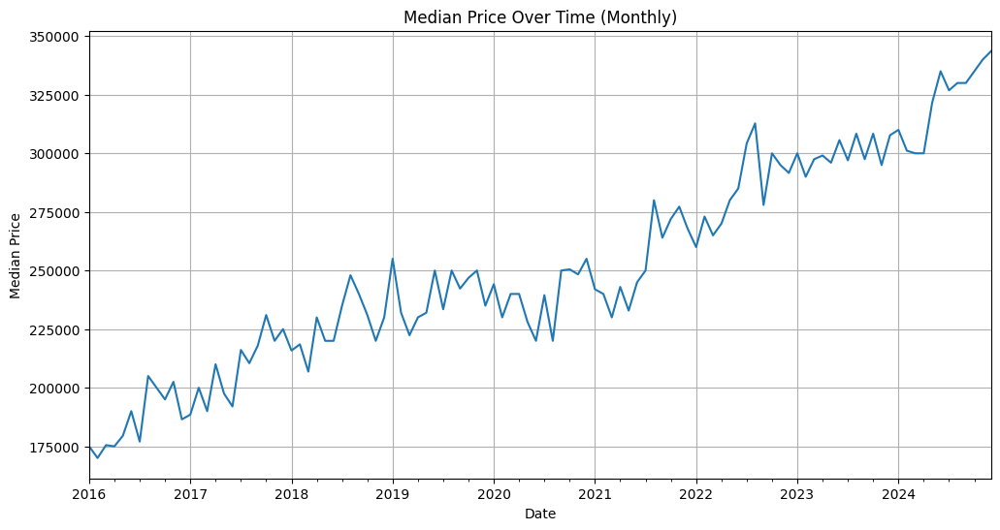
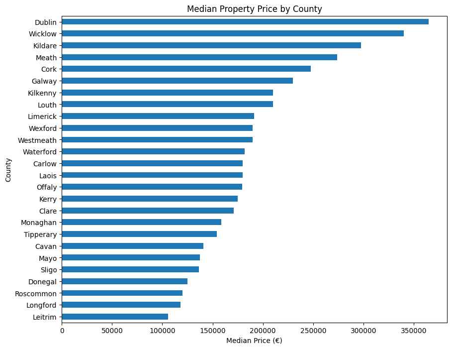

# Irish Residential Property Price Analytics

**MSc Data Analytics project | Assessment grade: 99% (A+)**

An analysis of **54,000 Irish residential property transactions**, with a separate 10,000-record raw test set, combining data-quality assessment, reusable preprocessing, geocoding and neighbourhood enrichment to investigate property price prediction.

## Approach

- Produced a formal Data Quality Report and Plan covering missingness, duplicates, high-cardinality fields, inconsistent categories and extreme prices.
- Implemented reusable Python/pandas cleaning functions, reusing training-derived price thresholds on the test set.
- Standardised addresses and enriched transactions with coordinates, calendar features and CSO small-area socioeconomic indicators.
- Compared Linear Regression and Random Forest across raw, clamped and log-transformed price targets, using five-fold `TimeSeriesSplit` cross-validation and a separate hold-out test set.

**Stack:** Python, pandas, NumPy, Matplotlib, Seaborn, GeoPandas, scikit-learn and Mapbox. Neighbourhood indicators come from [CSO Census 2022 Small Area Population Statistics](https://www.cso.ie/en/census/census2022/census2022smallareapopulationstatistics/).

## Results

Hold-out results for the Random Forest models trained and evaluated on **prices capped at the training-set 99th percentile**:

| Configuration | MAE | RMSE | R² |
| --- | ---: | ---: | ---: |
| Baseline pipeline | €162,940.55 | €236,478.73 | 0.0668 |
| Enriched pipeline | €136,776.27 | €206,622.44 | 0.2876 |

The enriched configuration reduced MAE by approximately **16%**, or **€26,164**. These figures are recorded in the final notebook's hold-out result tables. The notebook also reports uncapped and log-target experiments.

Prediction error remains substantial. The analysis identifies missing building-level information, including floor area, room counts and energy ratings, as an important limitation.

## Analysis examples

Monthly median prices in the project dataset illustrate the motivation for temporal features.



<details>
<summary>View geographic variation</summary>

County-level medians motivate more granular location and neighbourhood features.



</details>

## Run locally

From the repository root:

```bash
conda create -n irish-property-analytics python=3.12 pip -y
conda activate irish-property-analytics
python -m pip install -r requirements.txt
cd notebooks
jupyter notebook property_price_analysis.ipynb
```

The [main notebook](notebooks/property_price_analysis.ipynb) uses the included transaction, geocoded and CSO CSVs; it does not require API credentials. Saved outputs are available for a quick review. Running all cells retrains the model comparisons and cross-validation.

The optional [geocoding notebook](notebooks/geocoding.ipynb) documents the enrichment process. Repeating it requires your own `MAPBOX_TOKEN` in a local `.env` file and the CSO boundary files `cso_small_areas.geojson` and `cso_lea.geojson` under `data/`. These boundary files are not bundled.

## Reports

- [Data Quality Report](documents/Data_Quality_Report.pdf)
- [Data Quality Plan](documents/Data_Quality_Plan.pdf)
- [Contribution Statement](documents/Contribution_Statement.pdf)

This portfolio copy preserves the final submitted analysis and saved results. Full model training has not been rerun while preparing this repository.
